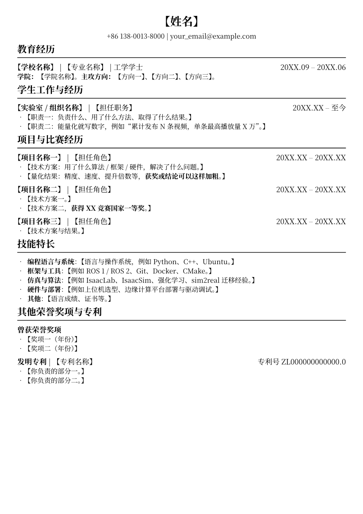

# RESUME_TEMPLATE · 中文单页简历 Typst 模板


一个**信息密度高、单页排得下**的中文简历模板，用 [Typst](https://typst.app/) 写成。
内容与样式分离，所有字段都是占位符，改 `main.typ` 一个文件就能产出自己的简历。



---

## 特性

- **单页排版**：专为中文简历的密集信息设计，字号与间距经过调整，一页放得下完整经历。
- **内容 / 样式分离**：`main.typ` 写内容，`template.typ` 管版式。换字体、调字号不用碰内容。
- **纯占位符**：模板中不含任何真实个人信息，`【】` 标出所有待填字段，搜索即可定位。
- **语义正确的字段**：`note` 参数专门放专利号这类右侧信息，不再拿日期字段凑。
- **空值安全**：职务、日期留空不会留下 ` | ` 或多余横线。
- **可移植字体**：字体按候选列表回退，换平台只需改一行。

## 环境要求

| 依赖 | 说明 |
| --- | --- |
| [Typst](https://github.com/typst/typst/releases) | ≥ 0.13，本项目在 **0.15.1** 上验证 |
| [`resume-ng`](https://typst.app/universe/package/resume-ng) | `@preview/resume-ng:1.0.0`，**首次编译时 Typst 自动下载**，之后离线可用 |
| 中文字体 | 默认 `Noto Serif SC`，缺失时回退 `Noto Serif CJK SC` → `SimSun` |

> 装 Typst：`winget install Typst.Typst`（Windows）／`brew install typst`（macOS）／`cargo install typst-cli`。

## 快速开始

### 方式 1：克隆后直接改（推荐）

```bash
git clone https://github.com/Terrorschiki/RESUME_TEMPLATE.git my-resume
cd my-resume
typst watch main.typ          # 保存即自动编译，产出 main.pdf
```

然后在编辑器里打开 `main.typ`，**搜索 `【` 逐个替换**即可。

### 方式 2：GitHub「Use this template」

点仓库右上角的 **Use this template → Create a new repository**，生成一份属于你自己的副本再克隆。

### 方式 3：注册成本地包，用 `typst init` 生成

`typst.toml` 已按 Typst 包规范写好。注意 `typst init` 只接受 `@` 开头的包名，
且目录层级必须是 `<包路径>/<命名空间>/<包名>/<版本>/`：

```powershell
# 1. 把模板放进本地包路径（层级不能少）
$pkg = "$env:TEMP\typst-local-pkg\local\resume-template\1.0.0"
New-Item -ItemType Directory -Force -Path $pkg | Out-Null
Copy-Item ".\*" $pkg -Recurse

# 2. 生成一份新简历
typst init "@local/resume-template:1.0.0" .\my-resume --package-path "$env:TEMP\typst-local-pkg"
```

> 长期使用可设 `TYPST_PACKAGE_PATH` 环境变量，就不用每次带 `--package-path`。
> 本模板**没有**发布到 Typst Universe，因此 `@preview/resume-template` 不可用。

## 你要改什么

打开 `main.typ`，搜索 `【` 替换所有正文占位符，另外这几处固定占位符也要改：

| 占位符 | 位置 | 说明 |
| --- | --- | --- |
| `【…】` | 全文 | 所有需要你填写的正文内容 |
| `【姓名】` | 第一个 `resume.with(...)` | 姓名，同时写入 PDF 文档属性 |
| `+86 138-0013-8000` | 同上 | 电话，`link("tel:…")` 里的号码要一起改 |
| `your_email@example.com` | 同上 | 邮箱，`mailto:…` 与显示文字两处 |
| `20XX.XX` | 各条目 | 起止时间 |

`main.typ` 里还预留了注释掉的 GitHub / 个人网站入口，需要就取消注释。

## 文件结构

```text
RESUME_TEMPLATE/
├── main.typ        # ★ 简历内容：只有这个文件需要你改
├── template.typ    # 版式与样式：字体、字号、条目结构都在这里
├── typst.toml      # Typst 包描述（方式 3 用）
├── preview.png     # 预览图 / 模板缩略图
├── LICENSE         # MIT
└── README.md       # 本文件
```

## 条目函数速查

模板提供四个函数。

### `resume`：文档抬头

```typst
#show: resume.with(
  name: "【姓名】",
  contacts: (
    link("tel:+8613800138000", "+86 138-0013-8000"),
    link("mailto:your_email@example.com", "your_email@example.com"),
  ),
)
```

`contacts` 里每一项是一段内容，自动用 ` | ` 连接。可选参数 `fonts` 单独指定字体。

### `resume-section`：章节标题

```typst
#resume-section("教育经历")
```

### `resume-education` / `resume-work` / `resume-project`：经历条目

```typst
#resume-education(university: "…", degree: "…", school: "…", start: "…", end: "…")[…]
#resume-work(company: "…", duty: "…", start: "…", end: "…")[…]
#resume-project(title: "…", duty: "…", start: "…", end: "…", note: "…")[…]
```

行为约定：

- **只填 `start`** → 右侧显示「今」，适合「至今」的经历；**起止都留空** → 右侧整块不渲染。
- **`duty` 留空** → 不会留下多余的 ` | `。
- **`note`** → 占据右侧时间的位置，用来放专利号、编号等；传了 `note` 就忽略 `start` / `end`。
- 正文用 `- ` 写列表，用 `*星号*` 加粗。**每一项都必须以 `- ` 开头**，否则会被当作上一条的续行。

## 自定义样式

改 `template.typ`：

```typst
// 字体：Typst 按顺序取第一个装了的字体
#let default-fonts = (
  "Noto Serif SC",
  "Noto Serif CJK SC",
  "SimSun",
)

// 条目标题（学校 / 单位 / 项目名）与右侧时间的字号
#let entry-size = 12pt
```

想换配色、改双栏，改造 `resume-section` 与 `resume-entry` 两个函数即可。
页面边距由 `resume-ng` 的 `project` 固定为 1cm，如需修改，在 `template.typ` 的 `resume` 里追加 `set page(margin: …)`。

## 常见问题

**Q：编译报 `unknown font family` 警告？**
字体候选列表里有你系统没装的字体。只是提示，不影响输出；想消除警告就把 `default-fonts` 改成只留你装了的那个，例如 macOS `("Songti SC", "STSong")`，Windows `("SimSun",)`。

**Q：第一次编译卡住 / 报找不到 `resume-ng`？**
需要联网下载依赖包。之后会缓存在 `%LOCALAPPDATA%\typst\packages\preview\resume-ng\1.0.0`，离线也能编译。

**Q：内容超出一页？**
精简每条经历的 bullet 数量，或调小 `entry-size`。

**Q：能直接改配色吗？**
本模板刻意保持单色字体排印风格，没有引入颜色；需要彩色版本建议自行改造 `template.typ`。

## 说明

版式参考自一份实际使用的中文单页简历，整理为模板时：

- 移除了全部个人信息（姓名、电话、邮箱、学校院系、实验室、项目名称、专利号、成绩与获奖名次等），一律改为占位符；
- 修掉了原稿中几处影响观感的细节：`duty` 为空时标题后悬挂的 ` | `、以空格开头的列表项被合并进上一段、借用日期字段显示专利号、无日期条目仍渲染横线。

## 鸣谢

感谢 [**Lain-Ego**](https://github.com/Lain-Ego0)：这份简历的原始版式当初是由 Lain-Ego 帮忙修改完成的，
本模板正是在那份简历的基础上整理而来。

## License

[MIT](LICENSE)。模板基于 MIT 许可的 [`resume-ng`](https://github.com/fky2015/resume-ng-typst) 构建。
你填入的正文内容版权归你自己。

---

## English

A dense, single-page **Chinese resume template** built with [Typst](https://typst.app/).
Content and styling are separated: edit `main.typ` only, and every field is a placeholder.

```bash
git clone https://github.com/Terrorschiki/RESUME_TEMPLATE.git my-resume
cd my-resume && typst watch main.typ
```

Search for `【` in `main.typ` to find every field to fill in. Requires Typst ≥ 0.13
(verified on 0.15.1) and the `@preview/resume-ng:1.0.0` package, which Typst downloads
automatically on first compile. Default CJK font is `Noto Serif SC`, falling back to
`Noto Serif CJK SC` / `SimSun`. Licensed under MIT.

The original resume layout was reworked for the author by
[**Lain-Ego**](https://github.com/Lain-Ego0) — many thanks.
